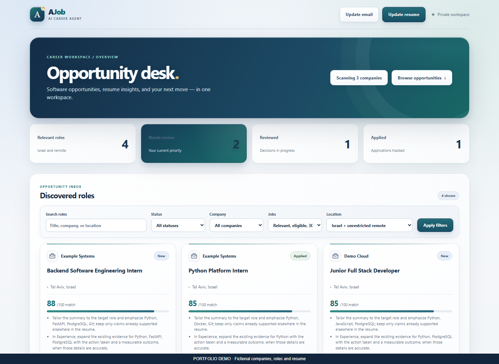
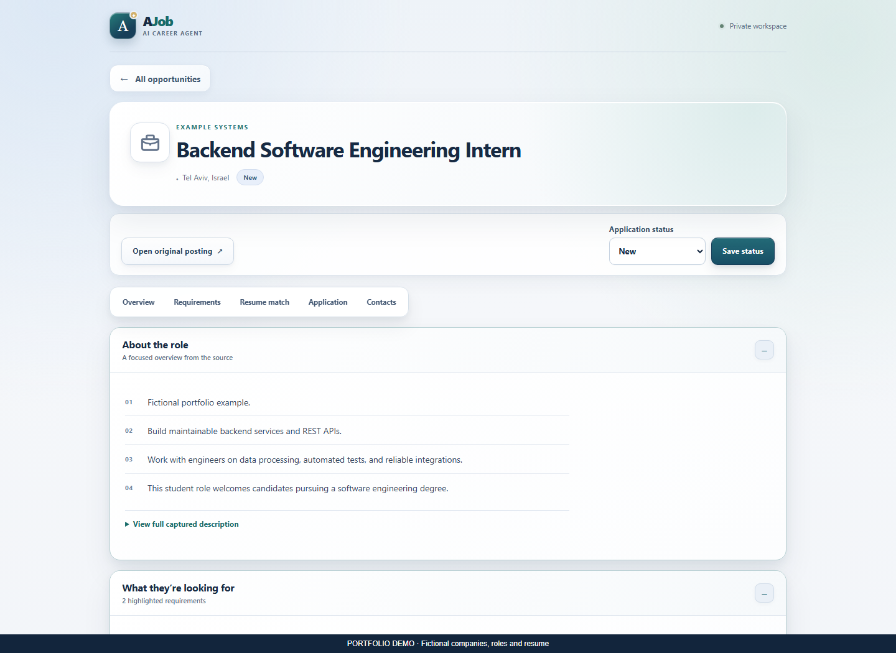
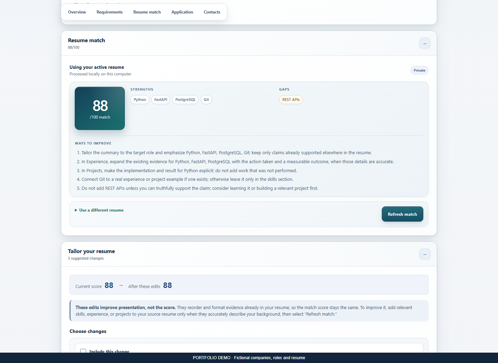
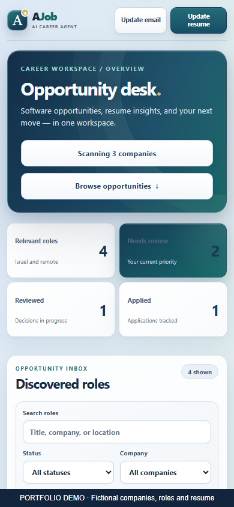
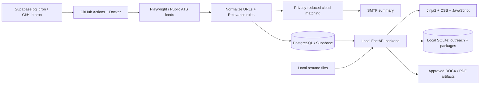

# AJob — Personal Job Discovery Workspace

**Active Development** · Python · FastAPI · Playwright · PostgreSQL · SQLite · Docker

AJob helps an early-career software developer turn scattered career pages into a
reviewable opportunity inbox. It is a working personal tool built by a third-year
software engineering student: cloud workers discover jobs, while a local dashboard
keeps resume analysis and application preparation on the user's computer.

## Why I built it

Checking employer sites manually is repetitive, listings overlap, and a job title
alone rarely establishes eligibility. AJob separates discovery, relevance rules,
resume evidence, and human decisions so each result can be explained and revisited.

## Interface

All screenshots below use **fictional employers, roles, and resume content**.
They are demonstrations, not live search results or performance measurements.



| Job workspace | Explainable resume matching |
| --- | --- |
|  |  |

<details>
<summary>Mobile layout</summary>

</details>

## What it does

- Discovers listings through Playwright and dedicated Workday, Greenhouse, and
  supported public-feed adapters, with bounded pagination and per-company failures.
- Filters early-career software roles and stores canonical URLs with idempotent
  upserts, preserving review and application status across scans.
- Parses local resumes and calculates deterministic, explainable skill matches,
  degree eligibility, and optional commute estimates.
- Presents filtered, score-ranked opportunities in a responsive local dashboard.
- Runs cloud scans at **08:17, 11:17, and 16:17 Asia/Jerusalem** and sends SMTP
  summaries after scanning. Persistent delivery slots coordinate retries.
- Prepares factual resume edits and application packages only after explicit
  approval. Outreach drafts are copied and sent manually; no applications or
  LinkedIn messages are sent automatically.

The configured source list is visible in the dashboard. Site availability and
coverage change; an enabled source does not guarantee listings or personal matches.

## Architecture



The cloud scanner and dashboard share job storage when `DATABASE_URL` is configured;
SQLite supports standalone local use. Matching, filtering, scraping, and storage
remain separate modules. Cloud matching receives a reduced profile, not contact
information or raw resume text. Local contact and application data stay in separate
SQLite databases.

Supabase can independently dispatch the GitHub workflow using a repository-scoped
credential in Vault. GitHub cron remains a fallback. Intended delivery slots follow
Israel daylight saving time and suppress ordinary duplicate retries. Hosted-runner
queues can delay scans; SMTP cannot promise exactly-once delivery.

### Technology choices

| Layer | Implementation |
| --- | --- |
| UI | Server-rendered Jinja2, responsive CSS, vanilla JavaScript |
| Backend | Python, FastAPI, Uvicorn, typed dataclasses |
| Discovery | Playwright/Chromium, public ATS JSON feeds, PyYAML configuration |
| Persistence | PostgreSQL through psycopg; SQLite locally |
| Resume processing | pypdf, python-docx, ReportLab, python-bidi |
| Automation | GitHub Actions, Docker, Supabase Cron and Vault |
| Verification | pytest, mocked integrations, Playwright regression tests |

## Run locally

Python **3.12** is used by CI and the container. From a clean checkout in PowerShell:

```powershell
py -3.12 -m venv .venv
.\.venv\Scripts\Activate.ps1
python -m pip install --upgrade "pip>=26.2,<27"
pip install -r requirements.txt
playwright install chromium
python -m src.main scan --dry-run
uvicorn src.web.app:app --host 127.0.0.1 --port 8001
```

Open `http://127.0.0.1:8001`. With no cloud configuration, the dashboard creates local
SQLite stores in `data/`; it initially has no discoveries. `--dry-run` previews
source configuration without fetching career sites or sending mail.

To scan a single configured employer manually, without email:

```powershell
python -m src.main scan --company "COMPANY_FROM_CONFIG" --max-pages 1
```

Keep the dashboard bound to loopback. It is a single-user local workspace, **not a
publicly hosted, authenticated web service**. `scripts/start_dashboard.ps1` provides
the Windows launcher; optional local database credentials use current-user DPAPI.
It is unnecessary to configure cloud services to inspect the UI or run unit tests.

### Configuration

Environment variables are read from the process; `.env` files are not automatically
loaded. Supply real values through a trusted secret store or local secure setup,
never through committed files or command history.

| Variable | Purpose / placeholder |
| --- | --- |
| `DATABASE_URL` | Optional PostgreSQL connection supplied securely by your provider; omit for local SQLite |
| `RESUME_DIRECTORY` | Optional local resume folder, such as `C:\path\to\private-resumes` |
| `SMTP_HOST`, `SMTP_PORT` | SMTP endpoint, e.g. `smtp.example.test`, `587` |
| `SMTP_USERNAME`, `SMTP_PASSWORD` | SMTP credentials; set securely |
| `SMTP_FROM`, `SMTP_TO` | Sender and recipient, e.g. `sender@example.test`, `recipient@example.test` |
| `SMTP_USE_TLS` | Defaults to `true`; disabling it is restricted to loopback development servers |
| `CANDIDATE_PROFILE_JSON` | Optional reduced profile for cloud matching; keep it private |

PostgreSQL connections should use `sslmode=verify-full` and a trusted provider CA.
The dashboard database account needs only SELECT and UPDATE(status) on job postings;
schema creation belongs to the scanner's initialization path.

To prepare a cloud profile, run `python -m src.main export-safe-profile` with a private
resume path. Review the output locally and store it as a GitHub Actions secret.
Although contact fields are removed, it still contains matching skills and location.

Cloud scans require persistent PostgreSQL and the SMTP repository secrets. See
[cloud dispatch setup](docs/cloud-dispatch.md) before configuring your own scheduler.
Do not dispatch workflows merely to preview this repository.

## Security and privacy

- Loopback Host allowlisting, cross-origin mutation checks, CSRF tokens, and
  anti-framing/browser security headers protect the local UI boundary.
- SMTP uses certificate and hostname validation before authentication.
- Resume uploads have type/size checks and confined filesystem paths. Rewrites and
  application preparation use explicit approval and server-held fingerprints.
- Secret and personal-file exclusions apply to Git and the Docker build context.
  The container copies only the public company configuration.
- Optional commute estimates send location queries to Nominatim and coordinates
  to OSRM; they are estimates, not live traffic data.

For verification results, remaining publication gates, and the approved commit-author
privacy policy, see [publication readiness](docs/publication-readiness.md).

## Tests and security checks

```powershell
python -m pytest -q
```

Tests use synthetic data, temporary stores, and mocked SMTP/HTTP integrations.
A browser regression test requires installed Chromium. Do not run a live scan or
send email to validate a code change when a focused test is sufficient.

Optional audit tooling can be installed in a separate virtual environment from
`requirements-audit.txt`. From the project root, using that environment:

```powershell
python scripts/audit_secrets.py --history
pip-audit --path .venv/Lib/site-packages --progress-spinner off
```

The secret scanner uses offline detect-secrets detectors and emits locations only.
CI also checks source/history secrets and dependency advisories. Advisory results
are time-dependent and do not replace review of permissions or runtime settings.

To reproduce the screenshots without accessing personal data or cloud services:

```powershell
python scripts/create_portfolio_screenshots.py
```

It uses disposable fictional data and a temporary loopback static server, blocks
external browser traffic, and writes only the four images under `docs/images/`.

## Project layout

```text
src/web/            Local UI and HTTP security boundary
src/scrapers/       Browser and public-feed discovery
src/filtering/      Role relevance rules
src/matching/       Explainable resume scoring
src/resume/         Local parsing and approved artifact generation
src/storage/        PostgreSQL and SQLite adapters
src/scheduling/     Israel-time delivery-slot validation
src/notifications/  SMTP and recipient settings
src/applications/  Human-approved application packages
src/outreach/      Manual-contact workspace
config/            Public employer configuration
scripts/           Local launcher, audit, and portfolio tooling
tests/             Behavior and security regression tests
```

## Limitations and next steps

Career-site changes can break adapters, filtering can miss suitable roles, and
matching is rule-based rather than an LLM judgment. Commute services have their own
availability and privacy limitations. The local dashboard does not provide
multi-user authorization. Future work should improve measured adapter coverage,
false-negative analysis, and dependency reproducibility without weakening privacy.

A concise, evidence-based project description is available in
[portfolio and resume notes](docs/portfolio.md).
